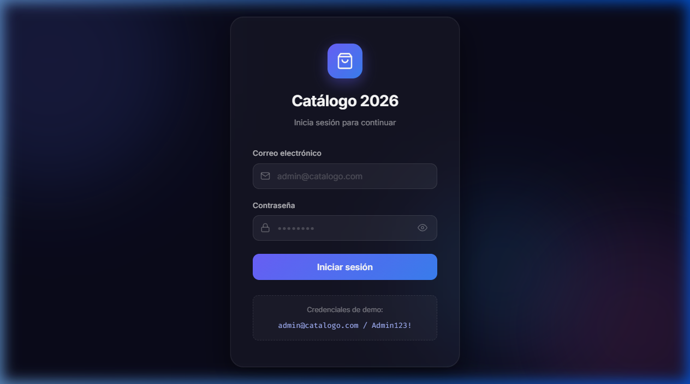
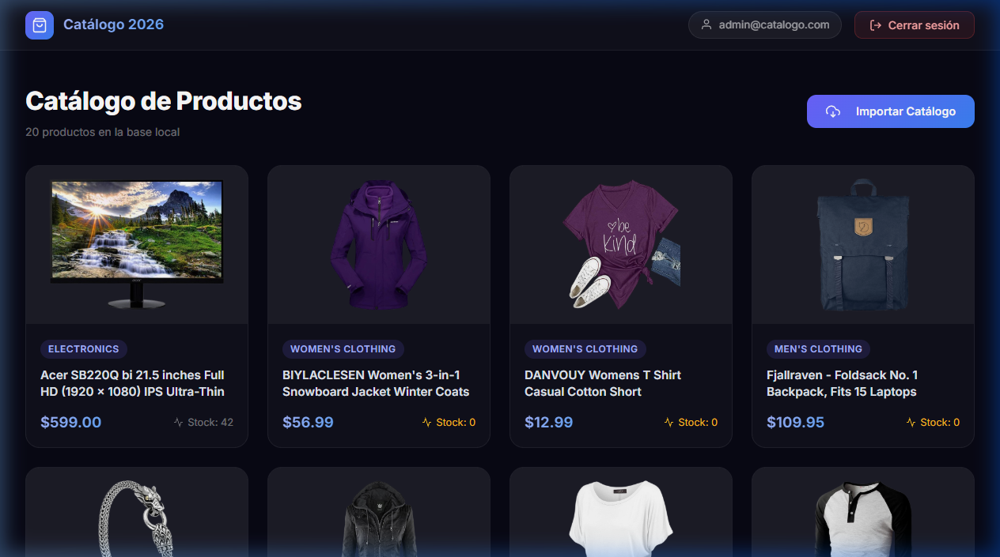
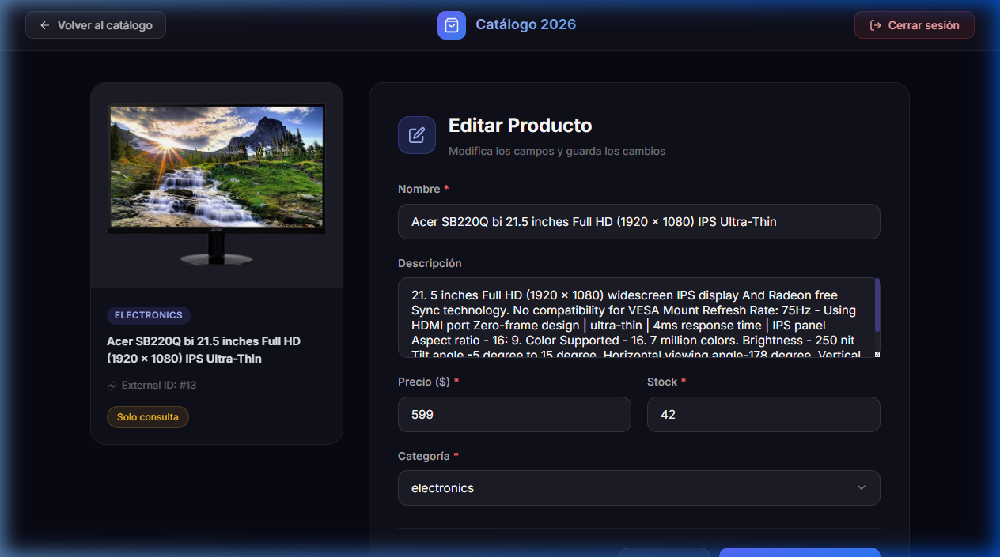

# 🛍️ Catálogo de Productos 2026

Aplicación web Full Stack para gestionar un catálogo de productos con autenticación JWT, importación desde Fake Store API y edición de productos.

---

## 📸 Capturas de pantalla

| Login | Catálogo | Edición |
|---|---|---|
|  |  |  |

---

## 🛠️ Stack Tecnológico

| Componente | Tecnología | Versión |
|---|---|---|
| Frontend | Angular + TypeScript | 19.x |
| Backend | C# .NET Web API | 10.0 |
| Base de datos | SQL Server | 2019+ |
| ORM | Entity Framework Core | 9.0 |
| Auth | JWT Bearer | - |
| Password hashing | BCrypt.Net-Next | 4.0.3 |

---

## ✅ Requisitos previos

- [.NET SDK 10.x](https://dotnet.microsoft.com/download)
- [Node.js 20.x o superior](https://nodejs.org/)
- [SQL Server 2019+](https://www.microsoft.com/es-es/sql-server/sql-server-downloads) (o SQL Server Express)
- Angular CLI 19 (`npm install -g @angular/cli@19`)

---

## ⚙️ Configuración

### 1. Base de datos (SQL Server)

La cadena de conexión por defecto usa autenticación Windows integrada con SQL Server Express:

```
Server=localhost\SQLEXPRESS;Database=CatalogoDB;Trusted_Connection=True;TrustServerCertificate=True;
```

Si usa **SQL Server sin Express** o **autenticación SQL Server**, edite `backend/CatalogAPI/appsettings.json`:

```json
"ConnectionStrings": {
  "DefaultConnection": "Server=localhost;Database=CatalogoDB;User Id=sa;Password=TuPassword;TrustServerCertificate=True;"
}
```

> 📁 Hay un archivo `appsettings.example.json` con ejemplos de configuración.

### 2. JWT (cambiar en producción)

El archivo `appsettings.json` ya incluye una clave funcional de ejemplo:

```json
"Jwt": {
  "Key": "ClaveSecretaMuyLargaYSegura_MinimoThirtyTwoCharacters!",
  "Issuer": "CatalogAPI",
  "Audience": "CatalogFrontend",
  "ExpirationMinutes": "60"
}
```

> ⚠️ **Nota JWT:** El token JWT no tiene revocación del lado del servidor. Al cerrar sesión se elimina del `localStorage` del cliente. El token permanece técnicamente válido hasta su expiración (60 min por defecto).

---

## 🚀 Pasos de ejecución

### Backend

```bash
cd backend/CatalogAPI

# El backend aplica las migraciones automáticamente y crea el usuario de prueba
dotnet run

# El servidor escucha en: http://localhost:5000
```

> **Primera ejecución:** El backend crea automáticamente la base de datos `CatalogoDB`, aplica todas las migraciones de EF Core y hace el seed del usuario admin con contraseña hasheada via BCrypt.

### Frontend

```bash
cd frontend/catalog-frontend

# Instalar dependencias (solo primera vez)
npm install

# Iniciar servidor de desarrollo
npm start
# o: ng serve

# El frontend estará en: http://localhost:4200
```

---

## 👤 Credenciales de demo

| Campo | Valor |
|---|---|
| Email | `admin@catalogo.com` |
| Contraseña | `Admin123!` |

El usuario se crea automáticamente al iniciar el backend por primera vez (via `Program.cs` con BCrypt work factor 11).

---

## 📦 Importación del catálogo

La importación se realiza **desde el frontend** usando el botón **"Importar Catálogo"** en la página del catálogo (requiere autenticación).

Esto llama al endpoint `POST /api/catalog/import` (protegido con JWT), que:

1. Consulta `GET https://fakestoreapi.com/products/categories` y guarda categorías nuevas
2. Consulta `GET https://fakestoreapi.com/products` y guarda productos por `ExternalId` único
3. Omite productos ya existentes (**no sobrescribe ediciones locales**)
4. Retorna un resumen: cuántos productos se importaron y cuántos se omitieron

**Idempotencia:** Re-ejecutar la importación es completamente seguro. No duplica datos ni sobrescribe ediciones locales.

**Manejo de errores:** Si la API externa no responde o devuelve datos inválidos, se informa el error en pantalla y se puede reintentar sin riesgo.

---

## 🔌 API Endpoints

| Método | Ruta | Auth | Descripción |
|---|---|---|---|
| POST | `/api/auth/login` | No | Iniciar sesión → devuelve JWT |
| GET | `/api/products` | Sí | Listar todos los productos locales |
| GET | `/api/products/{id}` | Sí | Obtener detalle de un producto |
| PUT | `/api/products/{id}` | Sí | Editar campos de un producto |
| GET | `/api/categories` | Sí | Listar categorías locales |
| POST | `/api/catalog/import` | Sí | Importar catálogo desde Fake Store API |

---

## 🗄️ Modelo de datos

```
Usuarios:   Id, Email (único), PasswordHash
Categorias: Id, Nombre (único)
Productos:  Id, ExternalId (único), Nombre, Descripcion,
            Precio (decimal 18,2), Stock (int), CategoriaId (FK → Categorias), ImagenUrl
```

---

## 🏗️ Arquitectura

```
PruebaProyecto1/
├── backend/
│   └── CatalogAPI/
│       ├── Controllers/      # AuthController, ProductsController,
│       │                     # CategoriesController, CatalogController
│       ├── Data/             # AppDbContext (EF Core)
│       ├── DTOs/             # AppDtos.cs (records C#)
│       ├── Migrations/       # Migraciones generadas por EF Core
│       ├── Models/           # Entidades: Usuario, Categoria, Producto
│       ├── Services/         # CatalogImportService, FakeStoreModels
│       ├── appsettings.json          # Configuración
│       ├── appsettings.example.json  # Ejemplo de configuración sin secretos
│       └── Program.cs        # Bootstrap: DI, middleware, migrations, seed
├── frontend/
│   └── catalog-frontend/
│       └── src/app/
│           ├── guards/        # authGuard (protege /catalog y /product/:id)
│           ├── interceptors/  # authInterceptor (agrega JWT automáticamente)
│           ├── models/        # Interfaces TypeScript
│           ├── pages/         # login, catalog, product-edit
│           └── services/      # AuthService (JWT + localStorage), CatalogService
└── database/
    └── init.sql               # Script SQL de referencia (el backend auto-migra)
```

---

## 🧠 Decisiones técnicas

1. **EF Core con migraciones automáticas**: Se aplican en `Program.cs` al iniciar. Elimina la necesidad de ejecutar comandos manuales de migración.
2. **Seed automático del usuario admin**: Creado en `Program.cs` con BCrypt (work factor 11). No requiere scripts adicionales.
3. **JWT sin revocación server-side**: Token expira en 60 minutos. Al hacer logout se elimina del `localStorage`. Documentado aquí y en el código.
4. **Angular standalone components**: Más modernos y menos boilerplate que NgModules. Routing lazy-loaded para mejor performance inicial.
5. **Importación idempotente por ExternalId**: Re-ejecutar nunca duplica. Los productos omitidos mantienen sus ediciones locales.
6. **JSON camelCase en backend**: `AddJsonOptions` con `CamelCase` garantiza compatibilidad con Angular (que espera camelCase por convención).
7. **BCrypt work factor 11**: Balance entre seguridad y rendimiento para hashing de contraseñas.
8. **Proxy de desarrollo Angular**: `proxy.conf.json` enruta `/api/*` al backend para desarrollo sin problemas de CORS.

---

## 🛠️ Herramientas utilizadas

- **Fake Store API** — fuente de datos externa para la importación del catálogo
- **Herramientas de desarrollo**: Visual Studio Code, Postman, documentación oficial de Microsoft .NET y Angular, y soporte de asistencia IA para consulta técnica y scaffolding de arquitectura.

---

## ⚠️ Funciones pendientes / fuera de alcance

Las siguientes funciones **no están implementadas** por estar explícitamente excluidas del alcance del desafío:

- Búsqueda y filtros de productos
- Paginación del listado
- Registro de usuarios y gestión de roles
- Creación manual de productos
- Eliminación de productos
- Administración de categorías
- Revocación server-side de tokens JWT (comportamiento documentado)
